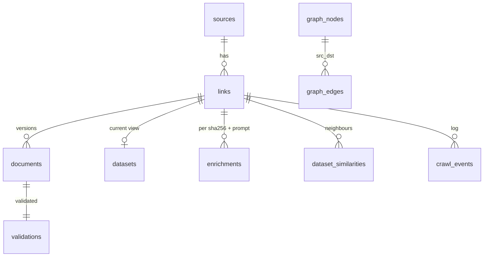

# Croissant Crawler — Technical Design Document

| | |
|---|---|
| **Status** | Implemented (v0.1) |
| **Last updated** | 2026-11-08 |
| **Companion doc** | [Product Requirements](PRD.md) |

## 1. Architecture at a glance

```mermaid
flowchart LR
  subgraph Sources["Repos (source adapters)"]
    HF[Hugging Face]:::s; OML[OpenML]:::s; KG[Kaggle]:::s; DV[Dataverse x N]:::s; WEB[Web / submissions]:::s
  end
  Sources -->|discover_page + cursor| L[(links<br/>crawl frontier<br/>+ timestamps)]
  L -->|lease SKIP LOCKED| F[fetch<br/>per-source rate-limited queue]
  F -->|sha256 canonical JSON| D[(documents<br/>Croissant store<br/>immutable versions)]
  D --> V[validate<br/>parse → shape → mlcroissant → rubric]
  V --> VS[(validations)]
  V --> DS[(datasets<br/>current normalised view)]
  DS --> IX[Typesense<br/>facets + BM25 + embeddings]
  DS --> LLM[LLM enrichment<br/>OpenRouter, cached by hash]
  LLM --> EN[(enrichments)] --> IX
  IX -->|vector kNN| SIM[(dataset_similarities)]
  DS & EN & SIM --> G[(graph_nodes / graph_edges)]
  IX & G & DS --> WEBUI[FastAPI: UI + JSON API]
  classDef s fill:#fdf3e3,stroke:#b45309
```



The same pipeline as containers (`docker compose up`):

```
┌──────────┐   ┌───────────┐   ┌───────────────────────────────┐   ┌──────────┐
│ web      │──▶│ postgres  │◀──│ worker                        │──▶│ typesense│
│ FastAPI  │   │ 16        │   │  main queue: workflows, CPU   │   │ 29 + ONNX│
│ Jinja2 + │──▶│ (state +  │   │  fetch-<source> queues (rate) │   │ MiniLM   │
│ htmx     │   │  store)   │   │  llm queue (rate, concurrency)│   └──────────┘
└────┬─────┘   └───────────┘   └──────────────┬────────────────┘
     │ start workflows / list runs            │ poll
     └──────────────────────────────▶ ┌───────▼────────┐
                                      │ temporal       │ dev server, SQLite, UI :8233
                                      └────────────────┘
```

Five containers, with no Elasticsearch or Cassandra. Temporal runs as its single-binary dev
server on SQLite.

## 2. Design lessons and the resulting decisions

This project replaces an earlier internal prototype. These are the problems that shaped the design.

| Problem with the naive approach | Consequence | Decision here |
|---|---|---|
| Crawl state kept as files keyed by encoded URLs | No queries, no timestamps, no history, an existence check per file, object-store throttling from many small writes | **Postgres is the system of record**: `links` is the frontier with explicit timestamps; `documents` holds immutable versions |
| URL lists maintained as static files | Stale and duplicated; no notion of "seen again" | Discovery upserts into `links` with `discovered_at` and `last_seen_at`; cursors are checkpointed |
| Business logic embedded in workflow activities | Hard to test; the orchestrator is required for everything | **Orchestrator-agnostic services** (`pipeline/*`). Activities are 1–3 line adapters. A local asyncio runner and tests use the same code |
| Batches of URLs and file paths passed through workflow payloads | Workflow-ID collisions, manual chunking, large payloads | Workflows pass **IDs only**, lease work from the DB, and **continue-as-new** to bound history |
| Rate limits configured per module and per process | Politeness depends on how many processes run | **Per-source Temporal task queues** with `max_task_queue_activities_per_second` (global) plus a per-host token bucket (local) |
| Validation as a binary "does the loader raise?" | Opaque; no way to rank or explain quality | Tiered validation, error and warning lists, a versioned **quality rubric** with a per-check breakdown |
| Mixing model metadata with dataset metadata | Scope creep and heavy dependencies | Datasets only. Lean dependencies (FastAPI, httpx, psycopg, temporalio, mlcroissant) |
| Multiple Python dependency managers | Lockfile drift | uv only |
| A full production Temporal topology for local development | Slow, RAM-hungry local dev | `temporal server start-dev` with SQLite in one container |
| OpenML discovery through its Elasticsearch endpoint | That endpoint now returns 403 | OpenML REST listing API |

## 3. Components

### 3.1 Source adapters (`sources/`)

Interface: `discover_page(client, cursor) → DiscoveryPage(links, next_cursor)` and `croissant_url(id)`.
Each `DiscoveredLink` has `external_id`, `croissant_url`, `landing_url`, `source_version`
(the upstream revision marker), `popularity` and `meta`.

| Source | Listing | Croissant URL | `source_version` | Popularity |
|---|---|---|---|---|
| Hugging Face | `GET /api/datasets?filter=library:mlcroissant&sort=downloads&limit=1000`, `Link: rel=next` cursor | `/api/datasets/{id}/croissant` | git `sha` | downloads |
| OpenML | `GET /api/v1/json/data/list/limit/1000/offset/{n}/status/active` (412 marks the end) | `/croissant/dataset/{did}` | `v{version}:{md5}` | none |
| Kaggle | `GET /api/v1/datasets/list?page={n}&sortBy=votes` (anonymous, 20 per page) | `/datasets/{ref}/croissant/download` (302 to a signed GCS URL) | `currentVersionNumber` | downloadCount |
| Dataverse | `GET {instance}/api/search?q=*&type=dataset&fq=fileCount:[1 TO *]` across N instances | `{instance}/api/datasets/export?exporter=croissant&persistentId={doi}` | `versionId` | none |
| Web | `WEB_SEEDS` (URLs, HTML pages, sitemaps) and `/api/submit` | the URL itself; JSON-LD is extracted from HTML | none | none |

Adding a source means writing one roughly 80-line class and registering it in `sources/__init__.py`.

### 3.2 HTTP client (`http.py`)

* **Token bucket per host group** (`huggingface`, `kaggle`, …). Every request in the process shares it.
* **Rate-limit signals**: `Retry-After` (capped at 120 s) on 429/503. Hugging Face's
  `ratelimit: "api";r=<remaining>;t=<reset>` pauses the bucket when `r ≤ 2`.
* **Retries**: 408/425/429/5xx and transport errors use jittered exponential backoff. A plain
  `500` is retried only once, because converter bugs are deterministic.
* **Circuit breaker**: 8 consecutive failures open the circuit for 10 minutes. Fetches fail fast
  with `deferred` and are rescheduled 15 minutes out **without** counting as link errors.
  Orchestrators stop a source when half of a batch is deferred.
* **Conditional GET** (`If-None-Match` / `If-Modified-Since`), a 25 MB body cap, and a generic
  User-Agent with no personal data.

### 3.3 Frontier and change detection (`pipeline/store.py`, `pipeline/crawl.py`)

* **Leasing**: `UPDATE links SET lease_until = now() + 15 min WHERE id IN (SELECT … ORDER BY
  priority DESC, next_fetch_at FOR UPDATE SKIP LOCKED LIMIT n) RETURNING id`. This is safe with
  many concurrent workflows and workers. Expired leases are simply re-leased.
* **Three layers of change detection**, cheapest first:
  1. *Listing revision marker.* Discovery sees the HF `sha`, Kaggle version or Dataverse `versionId`.
     If it equals `fetched_source_version`, the fetch is **skipped** with no HTTP request. If it
     moved, the upsert sets `next_fetch_at = now()`, so changed datasets jump the queue.
  2. *Conditional GET*: a `304` counts as unchanged.
  3. *Content hash*: SHA-256 of canonical JSON (sorted keys). The same hash means no new version.
* **Adaptive revisit** (`next_interval_hours`): changed → `RECRAWL_MIN_HOURS` (24 h);
  unchanged → interval × 2 up to `RECRAWL_MAX_DAYS` (30 d); errors → 1 h, 2 h, 4 h …;
  404/403 → park at the maximum after 3 strikes (`gone`). The hard floor is 5 minutes, so a link
  is never fetched twice in one run.

### 3.4 Validation and quality (`pipeline/validate.py`, `quality.py`, `extract.py`)

1. **L0 parse.** Accepts a JSON object, a JSON array (first object), or an HTML page with
   `<script type="application/ld+json">` (the first block that looks like Croissant).
2. **L1 shape.** Requires `conformsTo` a Croissant URI, or a Croissant `@context` plus
   `@type: Dataset`. Otherwise the document is `not_croissant`.
3. **L2 spec.** Calls `mlcroissant.Metadata.from_json(ctx, doc)` with our own `Context` and reads
   `ctx.issues.errors` and `warnings`. When mlcroissant *raises* `ValidationError` instead of
   recording, the `- message` lines are unpacked. This takes about 2–20 ms per document (0.7 s for
   FineWeb's 267 KB file) and makes no network calls.
4. **L3 quality rubric** (`RUBRIC_VERSION = q1`). It totals 100 points:

| Category | Weight | Checks |
|---|---:|---|
| Validity | 25 | no mlcroissant errors (20), few warnings (5) |
| Descriptive metadata | 30 | name, substantive description (length and boilerplate test), recognised license, creator or publisher, URL, dates, ≥3 keywords, citeAs, version |
| Distribution | 20 | has files, content URLs, encodingFormat, checksums, size |
| Structure | 15 | record sets, typed fields (ratio), field descriptions (ratio) |
| Responsible AI | 10 | `rai:*` and core RAI properties (4 or more for full marks) |

Documents with errors are capped at 49 and get tier **F**. Otherwise the tiers are A ≥ 80,
B ≥ 65, C ≥ 50, D below that. The breakdown is stored as JSON and rendered in the UI.
`VALIDATOR_VERSION = mlc-<version>+<rubric>` is stored per validation, and
`croissant-crawler revalidate` re-scores stale results offline.

The **extractor** normalises messy JSON-LD: prefixed keys (`sc:name`, `schema:name`), `@value`
objects, lists, person names split into given and family, licenses as strings, objects or lists
(normalised to SPDX-like IDs), sizes such as `"10.83 KB"`, partial dates, RAI properties, and
arXiv/DOI identifiers. It also extracts deterministic hints from HF keywords: tasks, modalities
and size buckets.

### 3.5 Croissant store

`documents(link_id, sha256, size_bytes, fetched_at, content JSONB)` with `UNIQUE(link_id, sha256)`.
`links.current_document_id` points at the head. Postgres JSONB was chosen over a blob store
because the documents are small (median about 5 KB, maximum a few MB). That keeps everything
transactional and queryable, for example
`SELECT … WHERE content->>'conformsTo' LIKE '%1.1'`. `croissant-crawler export` streams the
current valid corpus to JSON Lines (gz) with a server-side cursor.

### 3.6 Search (`search.py`, `web/search_service.py`, `pipeline/index.py`)

* **Collection fields**: text (name, alternate names, keywords, summary, creators, description
  converted from Markdown to text); facets (source, license, tasks, modalities, domains, languages,
  formats, Croissant version, validation status, quality tier, `is_placeholder`); numerics
  (`quality_score`, `popularity`, `rank_score`, dates, counts).
* **Embeddings**: `embedding` is auto-computed by Typesense from `[name, summary, keywords,
  description]` with the built-in `ts/all-MiniLM-L12-v2` (384-d, ONNX, CPU). There is no external
  embedding API and no Python ML dependencies.
* **Ranking**:
  `rank_score = 0.6·quality/100 + 0.4·min(1, log10(1+downloads)/7) − 0.35·placeholder`.
  An empty query sorts by `rank_score`. Other queries sort by
  `_text_match(buckets: 6):desc, rank_score:desc`: relevance first, then quality and popularity
  *within* each relevance bucket. Without bucketing, an invalid F-tier file ranked first for
  "medical images". Semantic mode adds `embedding` to `query_by`, which gives Typesense hybrid rank
  fusion with α = 0.7 and a cosine-distance threshold of 0.55. Bucketing applies to the fused
  score too. If the model is unavailable, search falls back to keyword-only automatically.
* **Similar datasets**: `vector_query: embedding:([], id: <doc>, k)`.
* **Highlighting** uses control-character markers, then HTML-escapes, then swaps in `<mark>`.
  This makes injecting HTML from upstream descriptions impossible.

### 3.7 LLM enrichment (`llm.py`, `pipeline/enrich.py`)

* OpenRouter chat completions with `response_format: json_schema` (strict), `models: [primary,
  …fallbacks]` and `provider.require_parameters: true`. The default model is
  `anthropic/claude-haiku-5.5` with `google/gemini-2.5-flash-lite` as fallback.
  *Gotcha found in testing:* sending `temperature` makes Claude Haiku 5.5 ineligible under
  `require_parameters`, so every request silently fell back to the second model. We send no
  sampling parameters.
* **Refusals**: a safety-classifier false positive returns HTTP 200 with
  `finish_reason: content_filter` and empty content. We observed this on a microbiology dataset
  about a bacterial toxin. OpenRouter's `models` fallback does not cover that case, so the client
  walks the model list itself and moves to the next model on a refusal or empty answer.
* **Input** is a bounded digest of about 2.5k tokens: name, creators, license, keywords,
  formats, field names, identifiers, popularity and the description converted from Markdown to text
  (truncated to 3,500 characters).
* **Output schema**: `summary`, `tasks[]` (41-term enum), `modalities[]` (13), `domains[]` (25),
  `languages[]` (ISO 639-1), `organizations[]`, `derived_from[]`, `papers[]`,
  `quality_flags[]` (10), `is_test_or_placeholder`, `documentation_quality` (1–5).
* **Grounding**: paper IDs must literally occur in the digest. Organisations and `derived_from`
  must share a meaningful token with it. The first test run caught Gemini inventing arXiv IDs
  such as `2015.00001`; grounding drops them.
* **Caching**: `UNIQUE(link_id, sha256, prompt_version)`. Recrawls of unchanged documents never
  call the model. Bumping `PROMPT_VERSION` re-enriches on demand.
* **Cost**: about 2.65k input and 300 output tokens per dataset, roughly $0.0004 with Claude
  Haiku 5.5, or about $1.44 for the first 3,427 datasets. `usage.cost` is stored per row, but
  OpenRouter reported `0` for this model during the run, so the key's `limit_remaining` is the
  authoritative spend figure.

### 3.8 Knowledge graph (`pipeline/graph.py`)

The graph is rebuilt from scratch in one transaction (`DELETE` plus `COPY`) as a pure function of
`datasets`, `enrichments` and `dataset_similarities`. That takes seconds at 10⁴ datasets and
avoids incremental-consistency bugs.

| Edge | Built from |
|---|---|
| PUBLISHED_ON | `source_id` |
| CREATED_BY | Croissant `creator`/`author` (Person → `person:`, otherwise `org:`), the non-platform `publisher`, LLM `organizations` |
| LICENSED_UNDER | normalised license (except Unknown) |
| HAS_TASK / HAS_MODALITY / IN_DOMAIN | LLM facets ∪ deterministic HF hints |
| CITES | arXiv IDs from keywords, citeAs and description, plus grounded LLM papers |
| DERIVED_FROM | LLM `derived_from`, resolved by normalised name to crawled datasets, else an `external_dataset:` node |
| SAME_AS | identical normalised name (org prefix, "dataset" and version tokens stripped) on **different** platforms, in groups of 2–6, excluding generic names |
| SIMILAR_TO | Typesense kNN (k = 6, cosine similarity ≥ 0.6), computed incrementally per re-indexed dataset |

The UI overview shows hub nodes (top tasks, modalities, domains, licenses, organisations and
sources) with co-occurrence edges. Focus and expand fetch one-hop neighbourhoods on demand.

### 3.9 Orchestration (`orchestration/`)

**Task queues.** `croissant-main` runs workflows and CPU/DB activities. `croissant-fetch-<source>`
runs `fetch_link` only, with `max_task_queue_activities_per_second = SOURCE_RATES[source]`.
`croissant-llm` runs `enrich_link` with a rate limit and bounded concurrency. Rate limits on a
task queue are enforced **by the server**, so they hold no matter how many worker replicas run.

**Workflows.**

| Workflow | Shape |
|---|---|
| `PipelineWorkflow(sources, limit, enrich, graph)` | `ensure_sources` → one `SourceCrawlWorkflow` child per source in parallel → `index_pending` → `EnrichWorkflow` child (failure tolerated) → `GraphWorkflow` child. Exposes a `current_phase` query. |
| `SourceCrawlWorkflow` | Discover pages until the limit or end, then loop: lease ≤ 50 → parallel `fetch_link` on the source queue → `process_documents` (heartbeating) for those needing processing → `index_links`. Post-processing of batch *n* runs as a workflow task **concurrently with the fetches of batch n+1**, so the rate-limited fetch queue never idles (the first version had a batch barrier that cut Kaggle throughput to about 35 links/min against a 60/min budget). Stops when ≥ 50% of a batch is deferred. `continue_as_new` at 6,000 history events, carrying the cursor, stage, counters and stats. |
| `EnrichWorkflow` | select ≤ 50 unenriched → parallel `enrich_link` on the LLM queue → `index_links`. Fails loudly if a whole batch fails (bad key or model). |
| `GraphWorkflow` | `compute_similarities` (heartbeating, up to 2 h) → `rebuild_graph` |

Activities receive and return **IDs and small dicts**, never documents. That avoids Temporal's
payload limits and keeps history small.

**Schedules.** `croissant-crawler workflow schedule --cron "0 3 * * *"` creates a Temporal
Schedule that runs the pipeline nightly. Because of the change detection in §3.3, a nightly run
over unchanged data costs about one listing call per page and no document downloads.

**Graceful shutdown.** On SIGTERM or SIGINT the worker stops polling and drains in-flight
activities for 30 s; compose gives it a 45 s `stop_grace_period`. Without this, a killed worker's
activities wait for their start-to-close timeout, which we observed stall a source for about
10 minutes. Fetch and index timeouts are now 4 and 3 minutes.

**Local runner.** `croissant-crawler run` composes the same services with `asyncio.gather` and
semaphores, for development, CI and one-off backfills without Temporal.

### 3.10 Web UI and API (`web/`)

FastAPI with Jinja2 templates, htmx (14 KB) and Cytoscape.js, vendored and pinned, so there is no
Node build and the UI works offline. Pages: Search (facets, live updates, pagination, semantic
toggle, placeholder toggle), Dataset (AI summary, description, record sets and fields, files,
validation messages, quality breakdown, metadata, crawl timeline, versions, related),
Graph, Crawl dashboard (KPIs, per-source table with tier bars, start-workflow form, Temporal
runs, live events every 5 s, failures, common spec errors), Validate (URL or paste; "add to
index") and About. Light and dark themes follow `prefers-color-scheme`.

API (OpenAPI at `/docs`): `/api/search`, `/api/datasets/{id}`, `/api/datasets/{id}/croissant`,
`/api/datasets/{id}/similar`, `/api/documents/{doc_id}`, `/api/stats`, `/api/events`,
`/api/sources`, `/api/graph/{overview,node,search,stats,export}`, `POST /api/validate`,
`POST /api/submit`, `POST /api/admin/pipeline` (guarded by `ENABLE_ADMIN_ACTIONS`), `/healthz`.

## 4. Data model



Key columns:

* `links`: `source_id, external_id (unique together), croissant_url (unique), source_meta,
  source_version, fetched_source_version, popularity, priority, status, discovered_at,
  last_seen_at, last_fetched_at, last_changed_at, next_fetch_at, recrawl_hours, lease_until,
  fetch_count, consecutive_errors, http_status, etag, last_modified, final_url, last_error,
  current_document_id`
* `documents`: `link_id, sha256, size_bytes, fetched_at, content jsonb`
* `validations`: `document_id, validator_version, status, croissant_version, errors, warnings,
  quality_score, quality_tier, quality_breakdown, duration_ms`
* `datasets`: denormalised current record (name, description, license, creators, keywords, dates,
  structure counts, identifiers, `extra` JSON, validation status, score, `indexed_at`)
* `enrichments`: `link_id, sha256, prompt_version, model, output, tokens, cost_usd`
* `graph_nodes(id, type, label, props)` and `graph_edges(src, dst, type, weight, props)`
* `crawl_events(at, source_id, link_id, kind, detail)`: an append-only activity log

Migrations are plain SQL files in `migrations/`, applied by a forward-only runner that is
serialised with an advisory lock (web and worker start concurrently).

## 5. Failure modes

| Failure | Behaviour |
|---|---|
| Upstream returns 5xx repeatedly | Circuit opens; links are deferred without penalty; the source workflow stops; other sources continue |
| Upstream 429 | Bucket blocked for `Retry-After`; HF's budget header pre-emptively pauses |
| 404 / 410 | `not_found`, then `gone` after 3 strikes; parked at the maximum revisit interval |
| Not Croissant / invalid JSON | `invalid` status, `last_error` recorded, dataset row removed if present |
| JSON containing `\u0000` (seen in a Kaggle file whose column names were raw ZIP bytes) | NULs are stripped at parse time, before hashing, because Postgres JSONB rejects them. Before this fix the fetch activity failed on every retry |
| Worker crash | Leases expire after 15 min; Temporal retries activities after start-to-close; workflows resume from history |
| Typesense down | Crawl continues; `indexed_at` stays NULL; `index_pending` catches up; the UI shows a banner |
| Embedding model unavailable | Search degrades to keyword-only |
| OpenRouter down or bad key | `EnrichWorkflow` fails while the pipeline continues; enrichment can be re-run later |
| Postgres down | Activities fail and retry with backoff; the web UI returns errors |

## 6. Security and compliance

* Secrets come only from env or `.env` (git-ignored, docker-ignored). The OpenRouter key never
  leaves the worker.
* Every upstream string is escaped by Jinja autoescape. Search snippets use the marker-then-escape
  technique. External links get `rel="noopener"`.
* `ENABLE_ADMIN_ACTIONS=false` disables workflow starts from the UI and API on shared
  deployments. `/api/submit` fetches arbitrary URLs, so put it behind auth or disable it on public
  hosts (SSRF consideration; listed as a P1 hardening item).
* Only metadata is stored. Landing pages are linked and attributed per source.

## 7. Testing strategy

| Layer | What | Where |
|---|---|---|
| Unit | Validation tiers on real fixtures from all four platforms plus a real invalid file, extraction edge cases, license normalisation, sizes and dates, Markdown stripping, revisit policy, enrichment clean and grounding, graph construction, search-param building and HTML escaping | `tests/test_*.py` |
| HTTP | Token bucket, Retry-After, the single 500 retry, circuit breaker, HF ratelimit header, size cap (respx) | `tests/test_http.py` |
| LLM client | Refusal (`content_filter`) falls through to the next model; no sampling params sent; all-models-fail raises | `tests/test_llm.py` |
| Sources | Pagination and cursors for each adapter (respx) | `tests/test_sources.py` |
| Workflows | Discover pagination, batching, limits, unhealthy-source stop, full pipeline, on Temporal's **time-skipping test server** with fake activities | `tests/test_workflows.py` |
| Integration | Real Postgres and Typesense: discovery, fetch, a 404, skip-when-unchanged, upstream change creating a second version, indexing, search, graph | `tests/test_integration.py` (`-m integration`) |
| Live | The crawl itself (README "Results") and headless-browser screenshots of every page | manual / CI later |

67 tests run in about 16 s locally. CI runs ruff, the whole suite with Postgres and Typesense
service containers, and a Docker build.

## 8. Scaling path

1. **Workers**: `docker compose up --scale worker=4`. Rate limits stay global because they are
   task-queue limits on the server.
2. **Temporal**: point `TEMPORAL_ADDRESS` at a production cluster or Temporal Cloud; nothing else changes.
3. **Postgres**: `documents.content` could move to object storage once the corpus reaches hundreds
   of GB; the table already isolates it. Add partial indexes for the frontier.
4. **Typesense**: a three-node cluster. For better semantic quality, swap the embedding model for
   a remote one (Typesense supports OpenAI-compatible endpoints) by changing one setting.
5. **Graph**: the Postgres tables export to Neo4j or Kùzu if traversal queries outgrow SQL.

## 9. Future work

Liveness probes of `contentUrl`s; robots.txt for the web source; an org alias table and
LLM-assisted entity resolution; LLM confirmation of SAME_AS candidates; enrichment and search
evaluation sets; version diffs; an MCP server; auth for the admin and submit endpoints;
multi-instance Dataverse discovery through the Dataverse installations registry; Zenodo.
